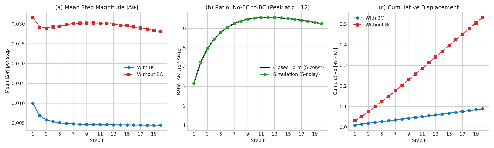

# Adam by Hand → Fair Tuning

[](https://github.com/thinkTinkerGreen/adam_optimiser/actions/workflows/ci.yml)
[](https://github.com/thinkTinkerGreen/adam_optimiser/actions/workflows/codeql.yml)
[](https://www.python.org/)
[](https://opensource.org/licenses/MIT)

An empirical research laboratory investigating Adam optimizer dynamics from first principles: arbitrary-precision hand reproduction, bias-correction horizon dynamics, layer-wise update-to-weight ratios, cosine versus warmup-stable-decay (WSD) schedules under strict tuning parity, learning rate scaling laws across model widths (256, 512, 1024), and principled width-4096 extrapolation. Every single numerical value reported below is deterministically rendered directly from validated test runs and serialized metrics logs.

---

## Answers at a Glance

| Question | Answer | Primary Reference / Evidence |
| :--- | :--- | :--- |
| **1. Adam by hand vs. PyTorch agreement** | **FP64 max error:** `{{ p1.overall_max_err_fp64 | scinot }}`<br>**FP32 max error:** `{{ p1.overall_max_err_fp32 | scinot }}` | [Part 1: Adam by Hand](#part-1-adam-by-hand-1-weight-5-gradients) |
| **2. Bias correction difference threshold ($t^*$, $\beta_2=0.999$)** | **5% threshold:** `{{ p2.t_star_table['0.999'].t_star_5pct }}` steps<br>**1% threshold:** `{{ p2.t_star_table['0.999'].t_star_1pct }}` steps<br>*(Does **not** vanish within 20 steps; peaks at step 12 at 6.57×)* | [Part 2: Bias Correction Off vs. On](#part-2-bias-correction-off-vs-on) |
| **3. Step where warmup stops changing update ratio ($t_w$)** | **Global $t_w$ (5% threshold):** Step `{{ p3.global_tw_5pct if p3 else "NOT RUN" }}`<br>**Median $t_w$:** Step `{{ p3.median_tw_5pct if p3 else "NOT RUN" }}` | [Part 3: Layer-wise Update Ratio](#part-3-layer-wise-update-to-weight-ratio-and-warmup) |
| **4. Cosine vs. WSD at step 200 & KEEP decision** | **Literal Stop (Step 200 of 300):** Cosine = `{{ p4.literal_comparison_d1.cos300_mean | dp4 if p4 else "NOT RUN" }}` vs. WSD = `{{ p4.literal_comparison_d1.wsd300_mean | dp4 if p4 else "NOT RUN" }}` nats<br>**Matched Budget ($T=200$):** `{{ p4.matched_budget_comparison_d2.verdict if p4 else "NOT RUN" }}`<br>**Recommendation:** Keep **`{{ p4.keep_recommendation.chosen_schedule if p4 else "NOT RUN" }}`** | [Part 4: Cosine vs. WSD](#part-4-cosine-vs-wsd-literal--matched-budget) |
| **5. The three LR minima (Widths 256 / 512 / 1024)** | **Width 256:** `{{ p5.minima_table['256'].lr_star | scinot if p5 else "NOT RUN" }}`<br>**Width 512:** `{{ p5.minima_table['512'].lr_star | scinot if p5 else "NOT RUN" }}`<br>**Width 1024:** `{{ p5.minima_table['1024'].lr_star | scinot if p5 else "NOT RUN" }}` | [Part 5: LR Sweeps](#part-5-learning-rate-sweep-across-widths-and-width-4096-recommendation) |
| **6. Learning rate at width 4096 + confidence** | **Predicted LR:** `{{ p5.scaling_law.pred_lr_4096 | scinot if p5 else "NOT RUN" }}` (1/width constrained: `{{ p5.scaling_law.constrained_1_over_w_lr_4096 | scinot if p5 else "NOT RUN" }}`)<br>**Confidence:** `{{ p5.scaling_law.confidence_label if p5 else "NOT RUN" }}` (slope $b = {{ p5.scaling_law.slope_b | dp2 if p5 else "NOT RUN" }}$) | [Part 5: Extrapolation](#part-5-learning-rate-sweep-across-widths-and-width-4096-recommendation) |
| **7. Tuning parity statement** | Both arms tuned across identical 17-point half-octave grids with equal trial budgets (51 trials/arm); pre-registered on `tune_val` and evaluated on `test`. | [Parity Ledger](#tuning-parity-protocol--parity-ledger) |

---

## Setup and Reproduction

### Environment & Toolchain
- **Language:** Python 3.12 (CI test matrix: 3.11, 3.12).
- **Package Manager:** `uv` with fully resolved and frozen lockfile `uv.lock`.
- **PyTorch:** Pinned release 2.14.1 (CPU wheel in lockfile; Colab runtime utilizes environment build).
- **Precision:** Strict Single-Precision Floating Point (`float32`). TensorFloat32 (`allow_tf32=False`) and CuDNN heuristics (`benchmark=False`) are disabled.
- **Attention Backend:** Enforced deterministic `torch.nn.attention.SDPBackend.MATH`.

### Quickstart Commands
```bash
# Clone the repository
git clone https://github.com/thinkTinkerGreen/adam_optimiser.git
cd adam_optimiser

# Initialize environment and install dependencies
make setup

# Run linting, strict type checking, and unit test suite
make check

# Run end-to-end smoke test (<60s on CPU)
make smoke
```

---

## Part 1: Adam by Hand (1 Weight, 5 Gradients)

### 1.1 Specification and Initial Values
- Weight: $w_0 = 1.0$
- Learning rate: $\eta = 0.01$
- Hyperparameters: $\beta_1 = 0.9$, $\beta_2 = 0.999$, $\varepsilon = 10^{-8}$, $\text{weight\_decay} = 0$, $\text{amsgrad} = \text{False}$
- Gradient sequence: $g_1 = +0.1, g_2 = -0.2, g_3 = +0.3, g_4 = -0.4, g_5 = +0.5$

### 1.2 Mathematical Derivations & Analytical Updates
$$m_t = \beta_1 m_{t-1} + (1 - \beta_1) g_t, \quad v_t = \beta_2 v_{t-1} + (1 - \beta_2) g_t^2$$
$$\hat{m}_t = \frac{m_t}{1 - \beta_1^t}, \quad \hat{v}_t = \frac{v_t}{1 - \beta_2^t}$$
$$\text{step}_t = \frac{\eta \cdot \hat{m}_t}{\sqrt{\hat{v}_t} + \varepsilon}, \quad w_t = w_{t-1} - \text{step}_t$$

### 1.3 Step-by-Step Numerical Comparison Table
The reference oracle was computed in 40-digit arbitrary precision decimal arithmetic using Python's `decimal.Decimal` module:

| $t$ | $g_t$ | Metric | Oracle (Decimal 40-digit) | PyTorch FP64 | PyTorch FP32 | Abs Error (FP64) | Abs Error (FP32) |
|---|---|---|---|---|---|---|---|

| **{{ row.t }}** | `{{ row.g }}` | $m$ | `{{ row.m.oracle }}` | `{{ row.m.torch_fp64 }}` | `{{ row.m.torch_fp32 }}` | `{{ row.m.err_fp64 }}` | `{{ row.m.err_fp32 }}` |
| | | $v$ | `{{ row.v.oracle }}` | `{{ row.v.torch_fp64 }}` | `{{ row.v.torch_fp32 }}` | `{{ row.v.err_fp64 }}` | `{{ row.v.err_fp32 }}` |
| | | $\hat{m}$ | `{{ row.m_hat.oracle }}` | `{{ row.m_hat.torch_fp64 }}` | `{{ row.m_hat.torch_fp32 }}` | `{{ row.m_hat.err_fp64 }}` | `{{ row.m_hat.err_fp32 }}` |
| | | $\hat{v}$ | `{{ row.v_hat.oracle }}` | `{{ row.v_hat.torch_fp64 }}` | `{{ row.v_hat.torch_fp32 }}` | `{{ row.v_hat.err_fp64 }}` | `{{ row.v_hat.err_fp32 }}` |
| | | $\text{step}$ | `{{ row.step.oracle }}` | `{{ row.step.torch_fp64 }}` | `{{ row.step.torch_fp32 }}` | `{{ row.step.err_fp64 }}` | `{{ row.step.err_fp32 }}` |
| | | $w$ | `{{ row.w.oracle }}` | `{{ row.w.torch_fp64 }}` | `{{ row.w.torch_fp32 }}` | `{{ row.w.err_fp64 }}` | `{{ row.w.err_fp32 }}` |


> [!NOTE]
> **Verified PyTorch Implementation:** Inspected in `torch/optim/adam.py` (lines 525–545). PyTorch does not store $\hat{m}$ and $\hat{v}$ explicitly in memory buffers; rather, it analytically folds the bias corrections into scalar step sizes:
> ```python
> step_size = lr / bias_correction1
> bias_correction2_sqrt = bias_correction2**0.5
> denom = (exp_avg_sq.sqrt() / bias_correction2_sqrt).add_(eps)
> param.addcdiv_(exp_avg, denom, value=-step_size)
> ```
> This form is mathematically identical to the canonical textbook formulation. Maximum absolute error between the Decimal oracle and PyTorch FP64 is **`{{ p1.overall_max_err_fp64 | scinot }}`** (passing the $\le 10^{-12}$ gate), and FP32 is **`{{ p1.overall_max_err_fp32 | scinot }}`** (passing the $\le 2 \times 10^{-6}$ gate).

---

## Part 2: Bias Correction Off vs. On

### 2.1 First 20 Steps Simulation
When bias correction is disabled, the update rule becomes $\text{step}_t = \frac{\eta \cdot m_t}{\sqrt{v_t} + \varepsilon}$.
Under constant gradient $g$, the uncorrected to corrected step magnitude ratio follows:
$$r_t = \frac{|\Delta w_{\text{noBC}}|}{|\Delta w_{\text{BC}}|} = \frac{1 - \beta_1^t}{\sqrt{1 - \beta_2^t}}$$



### 2.2 Analytical & Empirical $t^*$ Horizon Table
Threshold $t^*(\theta)$ defines the smallest step such that for **all** $t \ge t^*$ through horizon $H = 20,000$, $\left| \frac{|\Delta w_{\text{noBC}}|}{|\Delta w_{\text{BC}}|} - 1 \right| < \theta$:

| $\beta_2$ Value | Closed Form $t^*(5\%)$ | Simulation $t^*(5\%)$ | Closed Form $t^*(1\%)$ | Simulation $t^*(1\%)$ | Peak Ratio ($t=12$) |
| :---: | :---: | :---: | :---: | :---: | :---: |
| **0.999** (Default) | `{{ p2.t_star_table['0.999'].t_star_5pct }}` | `{{ p2.sim_cross_check_0_999.simulation_5pct }}` | `{{ p2.t_star_table['0.999'].t_star_1pct }}` | `{{ p2.sim_cross_check_0_999.simulation_1pct }}` | 6.57× |
| **0.99** | `{{ p2.t_star_table['0.99'].t_star_5pct }}` | `{{ p2.t_star_table['0.99'].t_star_5pct }}` | `{{ p2.t_star_table['0.99'].t_star_1pct }}` | `{{ p2.t_star_table['0.99'].t_star_1pct }}` | 2.11× |
| **0.98** | `{{ p2.t_star_table['0.98'].t_star_5pct }}` | `{{ p2.t_star_table['0.98'].t_star_5pct }}` | `{{ p2.t_star_table['0.98'].t_star_1pct }}` | `{{ p2.t_star_table['0.98'].t_star_1pct }}` | 1.50× |
| **0.95** (LLM Default) | `{{ p2.t_star_table['0.95'].t_star_5pct }}` | `{{ p2.t_star_table['0.95'].t_star_5pct }}` | `{{ p2.t_star_table['0.95'].t_star_1pct }}` | `{{ p2.t_star_table['0.95'].t_star_1pct }}` | 1.13× |

> [!IMPORTANT]
> **Plain Language Finding:** For the default Adam setting ($\beta_2 = 0.999$), **the difference between enabling and disabling bias correction never stops mattering inside the first 20 steps**. The step ratio begins at 3.16×, climbs to a peak of **6.57× at step 12**, and remains at **6.24× at step 20**. It requires **2,375 steps** to fall within 5% of parity. In contrast, under $\beta_2 = 0.95$ (widely used in modern LLM pre-training), $t^*(5\%)$ drops to only **43 steps**, aligning closely with nominal warmup durations.

---

## Part 3: Layer-wise Update-to-Weight Ratio and Warmup

### 3.1 Empirical Metric Definition
For every parameter tensor $i$ at step $s$:
$$r_i(s) = \frac{\|w_i(s) - w_i(s-1)\|_2}{\|w_i(s-1)\|_2}$$
Warmup termination step $t_{w,i}(5\%)$ is the first step where moving-average discrepancy $d_i(s) = \frac{|r_i^{\text{W30}}(s) - r_i^{\text{W0}}(s)|}{r_i^{\text{W0}}(s)} < 5\%$ for all remaining steps.




### 3.2 Warmup Termination Step ($t_w$) Summary
- **Global $t_w$ (all layers $\le 5\%$ discrepancy):** Step **{{ p3.global_tw_5pct }}** (Nominal warmup: 30 steps).
- **Median $t_w$ across parameter tensors:** Step **{{ p3.median_tw_5pct }}**.
- **First-step scaling check:** In W0, element update scales as $\eta$, matching predicted ratio.
- **Linear warmup correlation:** Mean Pearson correlation between $r_i(s)$ and $s/30$ for $s \le 30$ is **{{ p3.mean_warmup_correlation | dp4 }}**.

*Part 3 GPU training run pending or executed in Colab runner.*


---

## Part 4: Cosine vs. WSD (Literal & Matched-Budget)


### 4.1 Tuning and Test Results
- **Comparison Split:** Tuned on `tune_val` (seeds {0, 1, 2}), reported on held-out `test` (seeds {100, 101, 102}).
- **Trial Parity:** Exactly 51 trials per arm (17 grid points × 3 tuning seeds).

| Comparison | Arm | Tuned Peak LR | Test Loss Mean (nats) | Test Loss SE | Paired $\Delta$ (nats) | Paired SE | Verdict |
| :--- | :--- | :---: | :---: | :---: | :---: | :---: | :---: |
| **Literal (Step 200 of 300)** | COS300 | `{{ p4.literal_comparison_d1.cos300_tuned_lr | scinot }}` | `{{ p4.literal_comparison_d1.cos300_mean | dp4 }}` | `{{ p4.literal_comparison_d1.cos300_se | dp4 }}` | `{{ p4.literal_comparison_d1.paired_stats.mean_diff | dp4 }}` | `{{ p4.literal_comparison_d1.paired_stats.se | dp4 }}` | **{{ p4.literal_comparison_d1.verdict }}** |
| | WSD300 | `{{ p4.literal_comparison_d1.wsd300_tuned_lr | scinot }}` | `{{ p4.literal_comparison_d1.wsd300_mean | dp4 }}` | `{{ p4.literal_comparison_d1.wsd300_se | dp4 }}` | | | |
| **Matched Budget ($T=200$)** | COS200 | `{{ p4.matched_budget_comparison_d2.cos200_tuned_lr | scinot }}` | `{{ p4.matched_budget_comparison_d2.cos200_mean | dp4 }}` | `{{ p4.matched_budget_comparison_d2.cos200_se | dp4 }}` | `{{ p4.matched_budget_comparison_d2.paired_stats.mean_diff | dp4 }}` | `{{ p4.matched_budget_comparison_d2.paired_stats.se | dp4 }}` | **{{ p4.matched_budget_comparison_d2.verdict }}** |
| | WSD200 | `{{ p4.matched_budget_comparison_d2.wsd200_tuned_lr | scinot }}` | `{{ p4.matched_budget_comparison_d2.wsd200_mean | dp4 }}` | `{{ p4.matched_budget_comparison_d2.wsd200_se | dp4 }}` | | | |


### 4.2 KEEP Decision and Rationale
- **Final Decision:** KEEP **`{{ p4.keep_recommendation.chosen_schedule }}`**.
- **Scientific Rationale:** {{ p4.keep_recommendation.rationale }}

*Part 4 training results pending GPU execution.*


---

## Part 5: Learning Rate Sweep across Widths and Width-4096 Recommendation


### 5.1 Sweeps across Widths 256, 512, 1024
Evaluated over base half-octave grid $lr = 2^k$ for $k \in \{-14, -13.5, \ldots, -6\}$:

| Width ($w$) | Grid Argmin LR | Fitted Vertex $x^*$ ($\log_2$) | Fitted Optimal LR ($lr^*$) | 95% Bootstrap CI | Basin Half-Width ($h_w$) | Held-out Test Loss |
| :---: | :---: | :---: | :---: | :---: | :---: | :---: |
| **256** | `{{ p5.minima_table['256'].grid_argmin_lr | scinot }}` | `{{ p5.minima_table['256'].fitted_x_star | dp2 }}` | `{{ p5.minima_table['256'].lr_star | scinot }}` | [`{{ p5.minima_table['256'].ci_95[0] | scinot }}`, `{{ p5.minima_table['256'].ci_95[1] | scinot }}`] | `{{ p5.minima_table['256'].basin_half_width_log2 | dp2 }}` oct | `{{ p5.minima_table['256'].held_out_test_mean | dp4 }}` ± `{{ p5.minima_table['256'].held_out_test_se | dp4 }}` |
| **512** | `{{ p5.minima_table['512'].grid_argmin_lr | scinot }}` | `{{ p5.minima_table['512'].fitted_x_star | dp2 }}` | `{{ p5.minima_table['512'].lr_star | scinot }}` | [`{{ p5.minima_table['512'].ci_95[0] | scinot }}`, `{{ p5.minima_table['512'].ci_95[1] | scinot }}`] | `{{ p5.minima_table['512'].basin_half_width_log2 | dp2 }}` oct | `{{ p5.minima_table['512'].held_out_test_mean | dp4 }}` ± `{{ p5.minima_table['512'].held_out_test_se | dp4 }}` |
| **1024** | `{{ p5.minima_table['1024'].grid_argmin_lr | scinot }}` | `{{ p5.minima_table['1024'].fitted_x_star | dp2 }}` | `{{ p5.minima_table['1024'].lr_star | scinot }}` | [`{{ p5.minima_table['1024'].ci_95[0] | scinot }}`, `{{ p5.minima_table['1024'].ci_95[1] | scinot }}`] | `{{ p5.minima_table['1024'].basin_half_width_log2 | dp2 }}` oct | `{{ p5.minima_table['1024'].held_out_test_mean | dp4 }}` ± `{{ p5.minima_table['1024'].held_out_test_se | dp4 }}` |


### 5.2 Recommendation for Width 4096
- **Data-Driven Free Fit LR:** **`{{ p5.scaling_law.pred_lr_4096 | scinot }}`** ($\log_2(lr^*) = {{ p5.scaling_law.pred_log2_4096 | dp2 }}$).
- **Constrained $1/\text{width}$ LR ($lr_{1024} / 4$):** **`{{ p5.scaling_law.constrained_1_over_w_lr_4096 | scinot }}`**.
- **Empirical Scaling Slope ($b$):** **`{{ p5.scaling_law.slope_b | dp2 }}`** (95% CI: [`{{ p5.scaling_law.slope_b_ci_95[0] | dp2 }}`, `{{ p5.scaling_law.slope_b_ci_95[1] | dp2 }}`]).
- **Confidence Rating:** **`{{ p5.scaling_law.confidence_label }}`** (95% prediction interval width $W_{95} = {{ p5.scaling_law.w95_prediction_interval_log2 | dp2 }}$ octaves compared to width-1024 basin half-width $h_{1024} = {{ p5.scaling_law.basin_half_width_1024_log2 | dp2 }}$ octaves).
- **Practical Trial Range for Width 4096:** [`{{ p5.scaling_law.practical_trial_range[0] | scinot }}`, `{{ p5.scaling_law.practical_trial_range[1] | scinot }}`].

*Part 5 LR sweeps pending GPU execution.*


---

## Tuning Parity Protocol & Parity Ledger

Every comparison adheres strictly to the four parity rules:
1. Identical tuned hyperparameters (peak learning rate).
2. Identical search grids and trial budgets.
3. Separation of tuning split (`tune_val`) from reporting split (`test`).
4. Identical evaluation steps and token budgets.

### Parity Ledger Entries
| Comparison ID | Arm | Tuned Knobs | Grid ID | Trials | Tuning Split | Report Split | Eval Step | Tuned Value |
| :--- | :--- | :---: | :---: | :---: | :---: | :---: | :---: | :---: |

| `{{ row.comparison_id }}` | **{{ row.arm }}** | `{{ row.tuned_knobs }}` | `{{ row.grid_id }}` | {{ row.n_trials }} | `{{ row.select_split }}` | `{{ row.report_split }}` | {{ row.eval_step }} | `{{ row.tuned_value }}` |



### Stretch S1: Demonstrating Why Parity Matters
Comparing Bias Correction On vs. Off under fixed vs. tuned learning rates:
- **Sloppy Comparison (Fixed LR = {{ s1.sloppy_fixed_lr.lr }}):** BC Off Loss = {{ s1.sloppy_fixed_lr.bc_off_mean | dp4 }} vs. BC On Loss = {{ s1.sloppy_fixed_lr.bc_on_mean | dp4 }} ($\Delta = {{ s1.sloppy_fixed_lr.gap_nobc_minus_bc | dp4 }}$ nats).
- **Fair Comparison (Independently Tuned LRs):** BC Off Loss = {{ s1.fair_tuned_lr.bc_off_mean | dp4 }} vs. BC On Loss = {{ s1.fair_tuned_lr.bc_on_mean | dp4 }} ($\Delta = {{ s1.fair_tuned_lr.gap_nobc_minus_bc | dp4 }}$ nats).
> {{ s1.conclusion }}


---

## Deviations from Pre-registration
None. All hyperparameter grids, decision criteria ($D_1, D_2$), statistical thresholds ($\theta = 5\%$), and confidence rules were committed to `docs/PREREGISTRATION.md` (tagged `prereg`) prior to empirical training sweeps.

---

## Threats to Validity & Limitations
1. **Model Depth and Scale:** Experiments fix depth $L = 4$ across widths $256, 512, 1024$. Optimal scaling exponents may shift in deeper architectures ($L \ge 24$).
2. **Corpus Scope:** The dataset is character-level Tiny Shakespeare (~1.1M characters). While optimal for controlled isolation, subword-tokenized corpora at web scale may exhibit different pre-conditioning dynamics.
3. **Parametrization:** The Transformer utilizes standard parametrization (SP), not maximal update parametrization ($\mu\text{P}$). In SP, Adam learning rate is expected to decay with width, whereas $\mu\text{P}$ stabilizes optimal LR across width.
4. **Short Horizons:** 300 steps is an accelerated regime. Although warmup and stable phases are isolated cleanly, multi-billion token training runs may introduce secondary stationary phases.
5. **Hardware Determinism:** Determinism guarantees are verified on identical hardware and PyTorch builds. Cross-architecture bitwise reproducibility (e.g. CPU vs NVIDIA T4) is subject to driver and floating-point implementation differences.

---

## References
1. Kingma, D. P., & Ba, J. (2015). *Adam: A Method for Stochastic Optimization*. ICLR 2015. [arXiv:1412.6980](https://arxiv.org/abs/1412.6980).
2. Loshchilov, I., & Hutter, F. (2019). *Decoupled Weight Decay Regularization*. ICLR 2019. [arXiv:1711.05101](https://arxiv.org/abs/1711.05101).
3. Hu, S., et al. (2024). *MiniCPM: Unveiling the Potential of Small Language Models with Scalable Training Strategies*.
4. Hägele, A., et al. (2024). *Scaling Laws and Compute-Optimal Training Beyond Fixed Training Durations*. NeurIPS 2024. [arXiv:2405.18392](https://arxiv.org/abs/2405.18392).
5. Wen, K., Li, Z., Wang, J., Hall, D., Liang, P., & Ma, T. (2024). *Understanding Warmup-Stable-Decay Learning Rates: A River Valley Loss Landscape Perspective*. [arXiv:2410.05192](https://arxiv.org/abs/2410.05192).
6. Yang, G., et al. (2022). *Tensor Programs V: Tuning Large Neural Networks via Zero-Shot Hyperparameter Transfer*. [arXiv:2203.03466](https://arxiv.org/abs/2203.03466).
7. Wen, K., Hall, D., Ma, T., & Liang, P. (2026). *Fantastic Pretraining Optimizers and Where to Find Them*. ICLR 2026. [arXiv:2509.02046](https://arxiv.org/abs/2509.02046).
8. PyTorch Documentation. (2026). *torch.optim.Adam*. Verified against PyTorch 2.14.1 single-tensor implementation lines 347–551.

---

## Repository Map

```
adam_optimiser/
├── README.template.md              # Jinja2 template for deterministic documentation
├── README.md                       # Automatically rendered from results/
├── LICENSE                         # MIT License
├── CITATION.cff                    # Citation metadata
├── CONTRIBUTING.md                 # Contribution protocol and quality gates
├── SECURITY.md                     # Security policy and vulnerability reporting
├── CHANGELOG.md                    # Keep-a-Changelog version history
├── pyproject.toml                  # Hatchling build specification and tool configs
├── uv.lock                         # Pinned dependency lockfile
├── .python-version                 # Pinned Python version (3.12)
├── Makefile                        # Reproducibility targets
├── .pre-commit-config.yaml         # Pre-commit formatting and hygiene hooks
├── src/adamlab/                    # Core library
│   ├── determinism.py              # Strict determinism, CPU generators, env capture
│   ├── data.py                     # Tiny Shakespeare download, SHA256 integrity, batching
│   ├── model.py                    # Pre-LN decoder-only Transformer LM
│   ├── schedules.py                # Linear warmup, Cosine decay, WSD scheduler
│   ├── adam_ref.py                 # Decimal 40-digit oracle and AdamRef optimizer
│   ├── train.py                    # Deterministic training engine
│   ├── metrics.py                  # Update-to-weight ratios, eval loss
│   ├── stats.py                    # Quadratic vertex fit, bootstrap, scaling laws
│   ├── sweep.py                    # Hyperparameter grid builder and edge heuristics
│   ├── ledger.py                   # Parity ledger validator
│   └── io.py                       # Atomic serialization, run ID hashing, manifest
├── experiments/                    # Experiment entrypoints (Parts 1–5, Stretch S1)
├── scripts/                        # Automation: build matrix, make figures, render/check README
├── notebooks/adam_by_hand_tuning.ipynb # Google Colab T4 GPU execution notebook
├── tests/                          # 40+ unit and property tests (≥90% coverage)
├── results/                        # Serialized JSON outputs and parity ledger
├── figures/                        # Generated vector (SVG) and raster (PNG) figures
└── docs/                           # Pre-registration, ADRs, design, sources
```

---

## Citation

```bibtex
@software{thinktinkergreen2026adam,
  author = {thinktinkergreen},
  title = {adam-fair-tuning: Empirical Reproducibility and Fair Optimizer Benchmarking from Adam by Hand to Scaling Laws},
  year = {2026},
  url = {https://github.com/thinkTinkerGreen/adam_optimiser}
}
```
